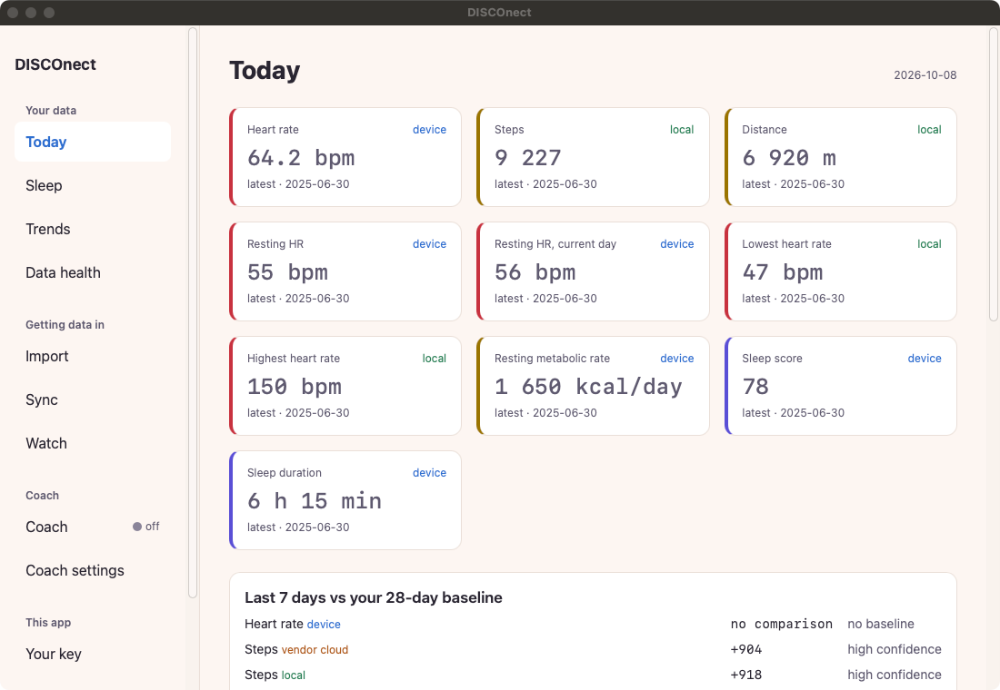
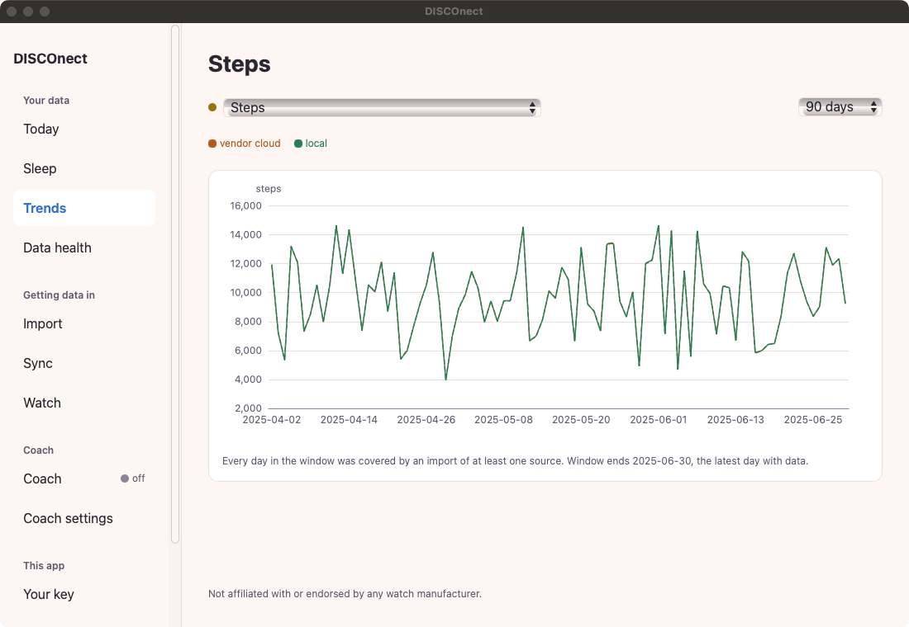
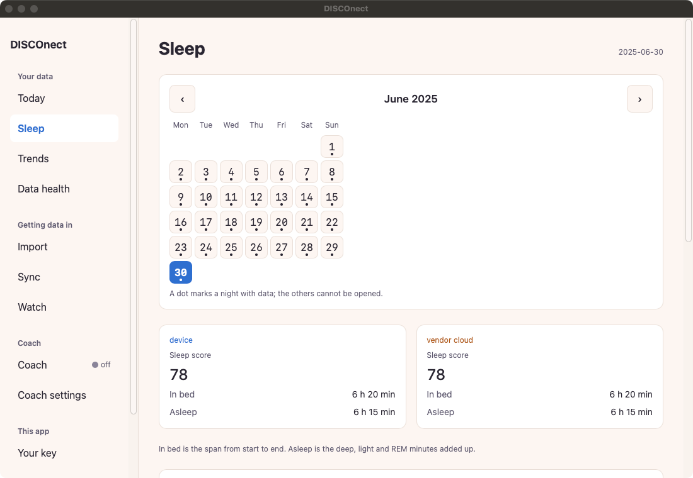
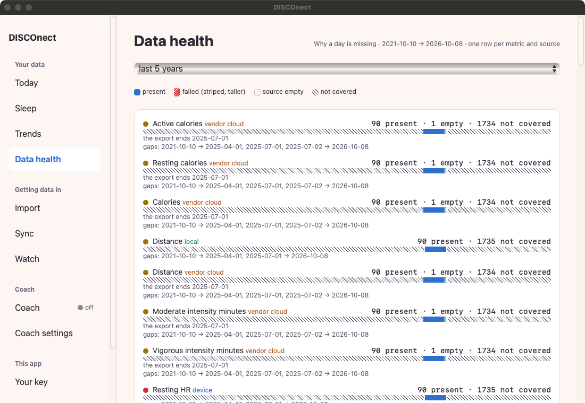
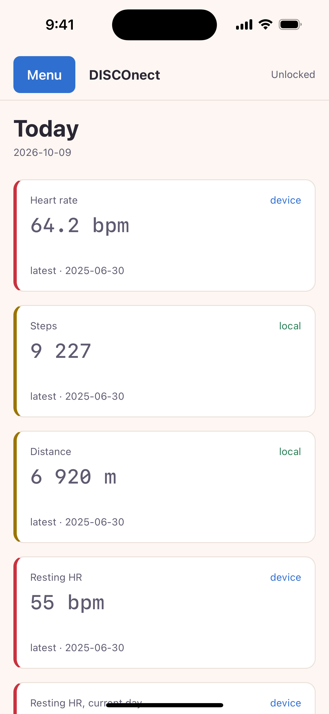
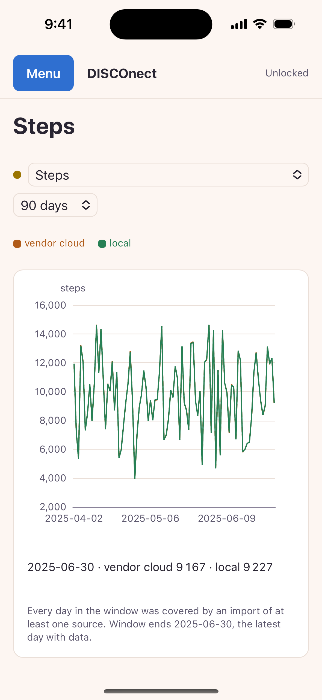
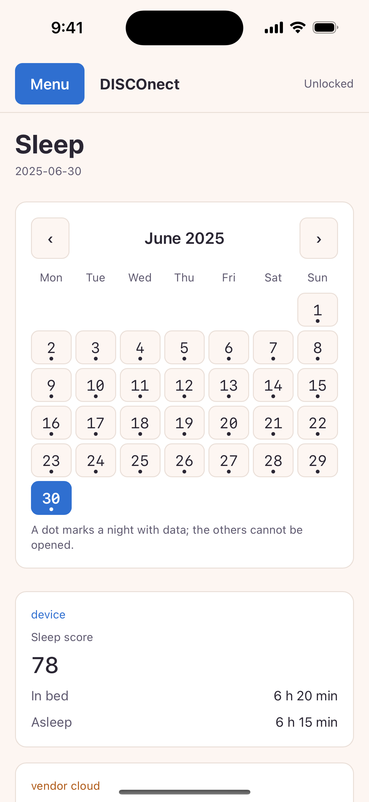
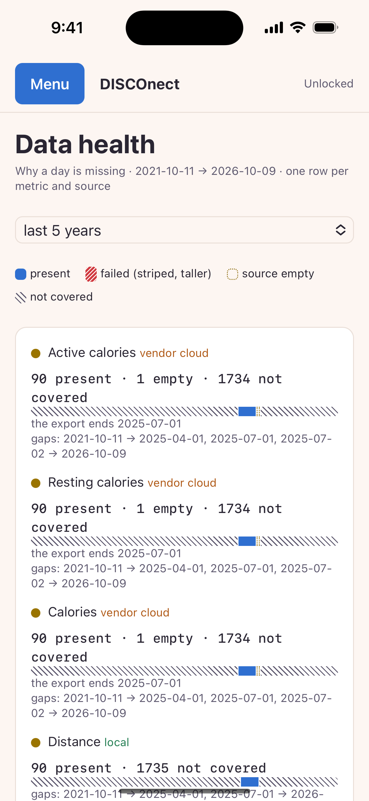

# DISCOnect app

The desktop (macOS) and iPhone app of DISCOnect, a local-first, cloud-free store for the health data a
Garmin watch records. `core/` is the Rust core: it decodes the watch's files into your own encrypted
SQLite store, answers the app over a JSON-lines protocol, serves an MCP server, and syncs your own devices
through a relay that only ever sees ciphertext. `app/` is the Tauri 2 shell over it, one crate for the Mac and
the iPhone, with device pairing by QR code and six digits.

**A personal project, done for the fun of it.** It explores what the data of one Garmin watch — bought
and owned by the maintainer — can do for its owner, using only the files the watch and the account
export hand him. It is not a product of Garmin's, is not meant to compete with or replace the Garmin
Connect app, and is not affiliated with, endorsed by or supported by Garmin Ltd. or any other company
named here; all rights in the watch, its firmware, its software and its services remain with Garmin
Ltd. and its licensors. See [TRADEMARKS.md](TRADEMARKS.md). What the software's own words may and may
not claim about your data is set out in [CLAIMS-POLICY.md](CLAIMS-POLICY.md), and linted.

**Status: v0, in progress.** The maintainer uses the Mac app and the iPhone app on his own data, and paired the
two once end to end on 2026-10-08; everything else is validated on synthetic data only. There is no App Store
or TestFlight build. Details and dates in [STATUS.md](STATUS.md).

The Python core, which this Rust core is held to by differential tests, is a separate repository:
<https://github.com/GuyShtainer/DISCOnect>.

## Screenshots

Made-up data: a seeded 90-day export written by the Python core's demo generator and imported here, no real person
(`app/docs/screenshots/make_screenshots.sh`). The Mac app and the iPhone app on the same store.

| Today | Trends | Sleep | Data health |
|---|---|---|---|
|  |  |  |  |
|  |  |  |  |

## Install and first run

You need Rust (stable, 2024 edition), Node 20 or newer, and for the iPhone build Xcode 26 with an iOS 18.1 or
newer runtime, CocoaPods, and the Rust targets `aarch64-apple-ios` and `aarch64-apple-ios-sim`. The commands run
from the repository root. Use a scratch database path while you try it.

**Mac, from source (debug, the core in-process):**

```sh
cargo run --release --manifest-path core/Cargo.toml -- --db /tmp/try/disconect.db import ~/Downloads/<your-connect-export>
cd app && npm ci
npx tauri dev -- -- --db /tmp/try/disconect.db
```

**Mac, a release bundle (the core as a sidecar):**

```sh
cargo build --release --locked --manifest-path core/Cargo.toml && cp core/target/release/disconect-core app/src-tauri/resources/disconect-core/
cd app && npm ci && npx tauri build --bundles app
open src-tauri/target/release/bundle/macos/disconect-app.app
```

The bundle is ad-hoc signed. A copy that arrived with a quarantine flag needs System Settings → Privacy &
Security → "Open Anyway" once.

**iPhone simulator:**

```sh
rustup target add aarch64-apple-ios aarch64-apple-ios-sim
cd app && npm ci
npx tauri ios dev "iPhone 16"
```

**Your own iPhone.** The Xcode project under `app/src-tauri/gen/apple/` carries no signing team and the
placeholder bundle identifier `org.disconect.app.dev`. Choose your own identifier in
`app/src-tauri/tauri.ios.conf.json`, `gen/apple/project.yml` and the Xcode project, and either select your own team
in Xcode (Signing & Capabilities) and run `npx tauri ios build`, or build an unsigned `.ipa` and let a
signing tool you trust sign it for your device. No certificate, provisioning profile or team id is in this
repository.

**Encryption and pairing.** The app opens a plain store or an encrypted one, but it never creates the key and never
shows recovery words: run `disconect key init` from the [Python core](https://github.com/GuyShtainer/DISCOnect) in a
terminal once. Pairing a phone needs that key: on the Mac's Sync screen, offer a pairing; on the phone, scan the QR
code and compare the six digits. The phone then pulls the encrypted bundles over your local network.

## Tests

```sh
cargo test --manifest-path core/Cargo.toml
cargo test --manifest-path app/src-tauri/Cargo.toml
cd app && npm ci && npx tsc --noEmit && npm run lint && npm run build
```

Every test runs on synthetic data: the FIT fixtures under `core/tests/fixtures/synthetic/` were synthesised, and
the committed oracle files (`core/contract.json`, `core/mcp.json`, `core/tests/fixtures/*.json`) pin the answers of
the Python core. No file from a real watch or account is in this repository. On a fresh clone (2026-10-09) the
suites read: core 485 passed and 41 skipped, app 188 passed and 33 skipped. The skipped tests need the Python core, its
test stores or the two-core differential harness, which are developed beside these crates and are not published
here (each says so in its reason), the Bluetooth client (not published either), or real data a stranger does not
have (an account export, the login keychain). Run the core's tests first: the app's in-process test compares itself
with the core binary they leave in `core/target/debug/`. `npm run lint` is the claims lint (see Layout).

## What it does

- **Core** (`core/`, a library and the `disconect-core` binary): the same store, key file and answers as the Python
  core. FIT files are parsed with `fitparser` (MIT); the account export's JSON layer, live-link session files
  (`live-*.jsonl`, written by a separate Bluetooth client that is not part of this repository) and replay of the
  retained raw bytes (`reparse`) follow the Python core's rules, held there by differential tests.
- **Serve protocol**: JSON lines over stdio (the Mac app's sidecar) or in-process (the iPhone, and debug builds):
  data reads, import with progress and cancel, unlock, pairing, sync. `core/docs/` holds the decoder and writer
  specifications the code implements.
- **MCP server** (`disconect-core mcp`, stdio, read-only): the tools listed in `core/mcp.json`.
- **Sync and pairing**: encrypted raw-record bundles through a folder you carry, or served over your local network
  by the Mac (`relay-serve`, header-authenticated HTTP); pairing exchanges the master key over an ephemeral X25519
  channel with a six-digit comparison. Protocols: the Python core's `docs/relay-protocol.md` and
  `docs/adr/0011-pairing-protocol.md`.
- **The app** (`app/`): Today, Trends, Sleep, Data health, Import, Sync and pairing, Your key, Settings. On the
  iPhone the key lives in the keychain (this device only), the data folder is excluded from backups, and the key
  file is unreadable while the phone is locked.
- **Coach** (off by default): a chat with a model *you* configure (a local server or a cloud endpoint, your key),
  through one egress function whose rules are in `app/README.md`; or a hand-off that opens a chat site in your
  browser for you to paste a day-level summary into. While coaching is off the app opens no network connection
  except the relay sync and relay serving you start yourself.
- **Support screen**: ships empty; no channel is configured in this build.

## Layout

```
core/                  Rust core (library + disconect-core binary), tests, fixtures, docs
app/                   Tauri 2 shell: src/ (TypeScript UI), src-tauri/ (Rust, iOS project under gen/apple)
app/third-party/       upstream licence notices and the iOS dependency licence list
CLAIMS-POLICY.md       what the app's own words may claim; app/scripts/claims-lint.mjs enforces it
```

## Third-party

`core` depends on `fitparser` (MIT; its licence text is `app/third-party/fitparser-LICENSE.txt`, because the
crates.io package ships none), SQLCipher and OpenSSL built from source through `rusqlite` (BSD-style and
Apache-2.0), and the RustCrypto and dalek crates (MIT / Apache-2.0). `app` adds Tauri 2 (MIT / Apache-2.0),
ECharts (Apache-2.0) and `qrcode-generator` (MIT). The iOS dependency set, crate by crate with its licence, is
`app/third-party/ios-crates.md`. Profile data inside `fitparser` is derived upstream from Garmin's FIT profile; it
is not redistributed by this project except as compiled from the upstream crate. This project never depends on
Garmin's FIT SDK.

## How it was built

Designed and reviewed by Guy Shtainer; implemented AI-assisted with Claude Code.

## License

Copyright (C) 2026 Guy Shtainer. AGPL-3.0-or-later ([LICENSE](LICENSE)), the core and the app alike. Third-party
marks and the non-affiliation statement: [TRADEMARKS.md](TRADEMARKS.md).

Code contributions are not open yet: issues are welcome, pull requests will not be merged for now.
